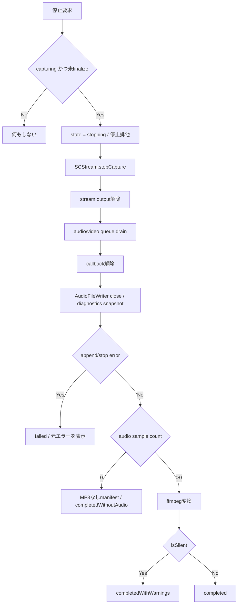

# 停止時の音声保存失敗 修正設計

## 0. 30秒サマリー

- 目的: 停止時に音声サンプルが0件でも、取得済み画像と診断manifestを失敗扱いにせず保存する。
- 実現可能性判定: `Yellow`
- 採用案: sample queueを停止時にdrainし、音声あり・無音・音声0件を区別して保存し、Unified Loggingとmanifestへ診断情報を残す。
- 変わる箇所: capture lifecycle、manifest、画面の警告表示、診断スクリプト、テスト、実行手順。
- 未確定: 音声0件が実際の無音、ScreenCaptureKit未配信、書込失敗のどれだったかは過去ログから確定不能。
- 次の判断: 追加のユーザー判断は不要。承認済みの「部分保存＋警告」で実装する。
- Feasibility Risks: ローカル環境にフルXcodeがなく、`swift test` は `XCTest not available`。実行中の `/Applications/EventRecorder.app` は古いx86_64版。

## 1. 目次

- [2. 概要](#2-概要)
- [3. Sources Used](#3-sources-used)
- [4. Known / Blocker / Open-ended / Chosen default](#4-known--blocker--open-ended--chosen-default)
- [5. 実現可能性評価](#5-実現可能性評価)
- [6. 代替案](#6-代替案)
- [7. 保存仕様](#7-保存仕様)
- [8. アーキテクチャと停止フロー](#8-アーキテクチャと停止フロー)
- [9. データ設計](#9-データ設計)
- [10. エラー処理とロギング](#10-エラー処理とロギング)
- [11. テスト戦略](#11-テスト戦略)
- [12. セキュリティと互換性](#12-セキュリティと互換性)
- [13. Check Answers](#13-check-answers)
- [14. Preview / Render Check](#14-preview--render-check)
- [15. Definition of Done](#15-definition-of-done)
- [16. 設計レビュー](#16-設計レビュー)

## 2. 概要

### ゴール

- 音声sampleが0件でも、画像と`manifest.json`を保存して`completedWithoutAudio`とする。
- sampleがあるが無音の場合はMP3とmanifestを保存し、`completedWithWarnings`とする。
- 音声がある場合は現行どおりMP3とmanifestを保存し、`completed`とする。
- append、stream停止、ffmpeg、manifest書込の実エラーは`.failed`のまま維持し、元エラーを汎用エラーで上書きしない。
- 停止連打と停止直前sampleの取りこぼしを防ぐ。
- 将来の再発時に、callback未配信と書込失敗をログとmanifestで区別できる。

### 非ゴール

- macOS 15以降専用の`SCRecordingOutput`への移行。
- マイク入力の追加。
- 新規依存、CI、権限仕様、macOS最小バージョンの変更。
- `/Applications/EventRecorder.app`の自動置換やTCC権限リセット。
- ScreenCaptureKit内部でsampleが届かない理由を推測で断定すること。

### 現地調査で確認した直接原因

- 検証時の4セッション中、3件は`images/`だけでCAF、MP3、manifestが存在しなかった。
- 正常1件は48kHz stereo、非無音sampleと有限の長さのCAFとMP3を生成した。
- `AudioFileWriter`は最初の正常appendまでCAFを生成しない。
- `CaptureSessionController.finalizeSession()`はCAF不在を`.noAudioCaptured`へ変換し、セッション全体を`.failed`にする。
- 実行中アプリのstdout/stderrは`/dev/null`で、現行`print`は保存されない。

## 3. Sources Used

- リサーチログ: [research.md](./research.md)
- Apple ScreenCaptureKit sample: <https://developer.apple.com/documentation/screencapturekit/capturing-screen-content-in-macos>
- Apple WWDC22 Meet ScreenCaptureKit: <https://developer.apple.com/videos/play/wwdc2022/10156/>
- Apple `SCStreamConfiguration`: <https://developer.apple.com/documentation/screencapturekit/scstreamconfiguration>
- Apple `stopCapture`: <https://developer.apple.com/documentation/screencapturekit/scstream/stopcapture%28completionhandler%3A%29>
- Apple `removeStreamOutput`: <https://developer.apple.com/documentation/screencapturekit/scstream/removestreamoutput%28_%3Atype%3A%29>
- Apple `AVAudioFile`: <https://developer.apple.com/documentation/avfaudio/avaudiofile>
- Apple Unified Logging: <https://developer.apple.com/documentation/os/generating-log-messages-from-your-code>
- Chromium ScreenCaptureKit loopback実装: <https://chromium.googlesource.com/chromium/src/+/HEAD/media/audio/mac/audio_loopback_input_mac_impl.mm>

設計へ反映した点:

- `startCapture()`成功とsample受信成功を分けて扱う。
- 出力を解除してsample queueをdrainしてからwriterを閉じる。
- dynamicなウィンドウ名、URL、保存先をログへ出さず、整数カウンタとsanitized errorだけを残す。
- display filterと48kHz stereoは既存方針を維持し、問題のない箇所を置換しない。

## 4. Known / Blocker / Open-ended / Chosen default

| 種別 | 項目 | 内容 | 対応 |
| --- | --- | --- | --- |
| Known | 音声0件時の扱い | ユーザーは「部分保存＋警告」を選択 | `completedWithoutAudio`としてmanifestを保存 |
| Known | 正常時フォーマット | 48kHz stereo PCMから128kbps MP3を生成できている | 既存設定を維持 |
| Known | 過去ログ | stdout/stderrが`/dev/null`で原因分類に不足 | Unified Loggingとmanifest diagnosticsを追加 |
| Blocker | なし | 実装を止める未決定事項はない | そのまま実装 |
| Open-ended | sample未配信のOS内部要因 | 現行証跡では確定不能 | 断定せず、再発時に分類できる診断を追加 |
| Chosen default | silent sample | MP3を保存し警告完了とする | `completedWithWarnings` |
| Chosen default | 旧manifest | 新フィールドをoptionalにする | decode後方互換を保つ |
| Chosen default | インストール | workspace内のappで検証する | `/Applications`は変更しない |

## 5. 実現可能性評価

- 判定: `Yellow`
- 主要根拠:
  - `swift build`と既存`scripts/build_app.sh`はフルXcodeなしで利用可能。
  - `swift test`はCommand Line Tools環境で`XCTest not available`となる。
  - 既存の実行中アプリは以前ビルドされたx86_64版で、workspaceの最新ソースと実行物が一致しない。
- Feasibility Risks:
  - ローカルだけではXCTestとXcode UIテストの成功証跡を作れない。
  - 実録画はTCC権限と実音声に依存し、自動化だけでは完全再現できない。
- mitigation:
  - 純粋なmanifest/finalize判断をSwiftPM対象へ置き、自動テスト可能な設計にする。
  - `swift build`、arm64 app build、プロセス起動スモーク、診断スクリプトをローカルゲートにする。
  - フルXcode環境で`swift test`と`xcodebuild`を最終リリースゲートにする。

## 6. 代替案

| 案 | 概要 | メリット | デメリット | 採用 |
| --- | --- | --- | --- | --- |
| A | 現行AVAudioFile方式を維持し、停止同期・診断・部分保存を追加 | macOS 13維持、差分最小、失敗を隠さない | ScreenCaptureKit内部要因は再発ログ待ち | 採用 |
| B | 音声0件時に無音MP3を生成 | 出力ファイル名が常に揃う | 音声取得失敗を正常録音に見せる | 不採用 |
| C | `SCRecordingOutput`へ移行 | framework側で記録完了を扱える | macOS 15以降、変更が大きい | 不採用 |
| D | 現行どおり全体失敗 | 変更が小さい | 取得済み画像を成功成果物として扱えない | 不採用 |

判断基準は、ユーザー選択、macOS 13互換性、診断可能性、差分最小である。

## 7. 保存仕様

| 条件 | MP3 | manifest | CaptureState | 画面表示 |
| --- | --- | --- | --- | --- |
| audio sampleあり・非無音 | 保存 | `completed` | `.completed` | 完了 |
| audio sampleあり・全sample無音 | 保存 | `completedWithWarnings` | `.completed` | 無音警告 |
| audio sample 0件 | 保存しない | `completedWithoutAudio` | `.completed` | 音声なし警告 |
| append失敗 | 可能な成果物を保持 | best effort診断 | `.failed` | 元のappendエラー |
| stream停止失敗 | 可能な成果物を保持 | best effort診断 | `.failed` | stream停止エラー |
| ffmpeg失敗 | CAFを保持 | best effort診断 | `.failed` | ffmpegエラー |
| manifest書込失敗 | 既存成果物を保持 | 書込失敗 | `.failed` | manifestエラー |

部分保存時の`audioFileName`は`nil`とし、無音MP3を生成しない。silent sampleは実データを含むためMP3を生成する。

## 8. アーキテクチャと停止フロー



責務:

- `ScreenCaptureService`: stream開始・停止、output解除、内部sample queueのdrain、stream error logging。
- `CaptureSessionController`: lifecycle排他、callback counters、writer error保持、finalizeとUI状態。
- `CaptureManifest`: 保存結果と診断情報の後方互換な永続化。
- `AudioFileWriter`: PCM書込と音量診断。sampleがない場合に偽の音声を生成しない。

## 9. データ設計

### `CaptureCompletionStatus`

- `completed`
- `completedWithWarnings`
- `completedWithoutAudio`

### `CaptureDiagnostics`

- `videoSampleBufferCount: UInt64`
- `audioSampleBufferCount: UInt64`
- `audioWriteSuccessCount: UInt64`
- `audioWriteFailureCount: UInt64`
- `firstAudioSamplePTSSeconds: Double?`
- `lastAudioSamplePTSSeconds: Double?`
- `audioWriteError: CaptureErrorRecord?`
- `streamStopError: CaptureErrorRecord?`

### `CaptureErrorRecord`

- `domain: String`
- `code: Int`

localizedDescription、ウィンドウ名、URL、保存先は保存しない。

### `CaptureManifest`

- `audioFileName`を`String?`へ変更。
- `completionStatus`と`captureDiagnostics`はoptionalで追加し、旧JSONをdecode可能にする。
- 新規manifestでは両フィールドを必ず設定する。

DB、migration、外部送信はない。既存JSONファイルをその場で書き換えない。

## 10. エラー処理とロギング

- subsystem: `io.github.eventrecorder.capture`
- category: `session`、`stream`、`audio`
- notice: capture開始、停止開始、finalize結果と整数カウンタ。
- error: append、stream停止、ffmpeg、manifest書込。
- dynamic stringはprivateのままか、保存せずdomain/codeへ変換する。
- `SCStreamError.Code.userStopped`相当はユーザー操作として扱い、意図しない停止エラーと区別する。
- append失敗をcallback内で即座に`.noAudioCaptured`へ変換せず、最初のエラーをsession diagnosticsへ保持する。

診断コマンド:

```bash
log show --last 10m --style compact \
  --predicate 'subsystem == "io.github.eventrecorder.capture"'
```

## 11. テスト戦略

### ユニット

- 旧manifestを新型へdecodeできる。
- 正常manifest、silent manifest、no-audio manifestをround-tripできる。
- audio sample 0件は`completedWithoutAudio`と`audioFileName == nil`になる。
- sampleありsilentは`completedWithWarnings`になる。
- sampleあり非無音は`completed`になる。
- append errorがno-audioエラーで上書きされない。
- 停止を複数回要求してもfinalizeが1回。

### ビルド・スモーク

```bash
swift build
swift test
./scripts/build_app.sh
file ./build/EventRecorder.app/Contents/MacOS/EventRecorder
open ./build/EventRecorder.app
```

期待:

- `swift build`成功。
- `swift test`はフルXcode環境では成功。Command Line Toolsのみの場合は環境制約を明記する。
- appバイナリがarm64。
- アプリが起動して主要画面を表示する。

### 実機回帰

- 既知の音声再生中に10回開始・停止し、10回とも非空MP3。
- 無音で3回開始・停止し、3回とも`completedWithoutAudio`。
- silent PCMを注入したテストで`completedWithWarnings`。
- 停止連打で重複変換や`sessionNotPrepared`が発生しない。
- 停止直前sampleがdrain後のカウンタとCAFへ反映される。

実機で録画・権限操作を行えない場合は、未実施として完了条件から除外せず、リリースゲート未達と記録する。

## 12. セキュリティと互換性

- ログへウィンドウタイトル、URL、絶対パス、音声内容を出さない。
- session IDと整数カウンタだけを公開値として使用する。
- TCC resetを自動実行しない。
- 新規依存を追加しない。
- macOS 13、既存ffmpeg経路、既存display filterを維持する。
- 旧manifestは新フィールドが欠けてもdecodeできる。

## 13. Check Answers

| 項目 | 状態 | 対応 |
| --- | --- | --- |
| 音声0件時の保存 | 回答済み | ユーザー選択「部分保存＋警告」 |
| Blocker | なし | 実装へ進む |
| Open-ended | OS内部のsample未配信理由 | 推測せず診断情報を追加 |
| Chosen default | silent sample | MP3保存＋警告完了 |
| Chosen default | 旧manifest | optionalフィールドで互換維持 |
| Feasibility Risks | XCTest不可、古いx86_64実行物 | arm64直接ビルド＋フルXcodeを最終ゲート |

## 14. Preview / Render Check

- 利用手段: `npx mdts docs --host localhost --port auto`
- Markdownディレクトリ: `docs`
- 起動コマンド: `npx mdts docs --host localhost --port auto`
- 実URL: `起動時に表示されるローカルURL`
- 起動シェル: preview専用TTY
- 停止方法: previewシェルで`Ctrl-C`。代替は実URLのLISTEN PIDを特定して`kill <pid>`。
- 確認観点:
  - [x] 目次リンク
  - [x] 見出し階層
  - [x] 表・箇条書き
  - [x] コードフェンス
  - [x] Mermaid描画

## 15. Definition of Done

- [ ] 音声0件でMP3を生成せず、画像とmanifestを保存する。
- [ ] 音声0件が`.failed`ではなく警告付き完了になる。
- [ ] silent sampleと音声0件をmanifestで区別できる。
- [ ] sample queueをdrainしてからwriterを閉じる。
- [ ] 停止連打でfinalizeが重複しない。
- [ ] appendエラーを汎用no-audioエラーで上書きしない。
- [ ] Unified Loggingとmanifest countersでcallback未配信と書込失敗を区別できる。
- [ ] 旧manifestのdecode互換をテストする。
- [ ] `swift build`とarm64 app buildが成功する。
- [ ] フルXcode環境で自動テストが成功する、または未達を明記して完了扱いにしない。
- [ ] README、実行手順、診断スクリプトが新仕様と一致する。
- [ ] Markdown previewの固定5観点を確認する。

## 16. 設計レビュー

- `1/5 要件整合`: 部分保存、診断、停止同期、互換性を網羅する。
- `2/5 unknown整理`: OS内部要因のみOpen-endedとし、事実化しない。
- `3/5 入出力とエラー`: 3完了状態と実エラーを分離する。
- `4/5 テストとDoD`: 自動、スモーク、実機の各証跡を定義する。
- `5/5 可読性・図・preview`: mdtsのDOMと画面で目次、階層、表、コード、Mermaidを確認し、実URLと停止方法を記録した。
