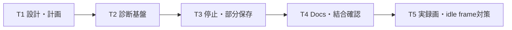

# 停止時の音声保存失敗 タスク計画

## 0. 30秒サマリー

- 目的: 音声0件でも画像と診断manifestを部分保存し、停止競合と観測性不足を修正する。
- 採用方針: 設計資料、診断基盤、停止/finalize修正、運用資料の4コミットに加え、実録画で判明した画像なしscreen sample対策を1コミット。
- 影響範囲: capture domain、controller、ScreenCaptureKit adapter、UI、tests、README、診断script。
- 最初の着手: manifest後方互換型と診断カウンタをSwiftPMでテスト可能にする。
- 未解決事項: Blockerなし。OS内部のsample未配信理由はOpen-endedとしてログで追跡する。
- 進捗: T1〜T5の実装と実録画回帰は完了。フルXcodeのXCTest/xcodebuildだけが未達。
- リリース判定: `Yellow`。未達ゲートを理由に最終完了扱いにしない。

## 1. 目次

- [2. Sources Used](#2-sources-used)
- [3. 前提](#3-前提)
- [4. 依存関係](#4-依存関係)
- [5. タスク一覧](#5-タスク一覧)
- [6. リスクと対応](#6-リスクと対応)
- [7. タスク計画レビュー](#7-タスク計画レビュー)

## 2. Sources Used

- リサーチログ: [research.md](./research.md)
- 設計: [design.md](./design.md)
- Apple ScreenCaptureKit sample: <https://developer.apple.com/documentation/screencapturekit/capturing-screen-content-in-macos>
- Apple Unified Logging: <https://developer.apple.com/documentation/os/generating-log-messages-from-your-code>
- Chromium ScreenCaptureKit audio implementation: <https://chromium.googlesource.com/chromium/src/+/HEAD/media/audio/mac/audio_loopback_input_mac_impl.mm>

影響したポイント:

- stream停止、output解除、queue drain、writer closeの順序を固定する。
- manifest schemaをoptional追加で後方互換にする。
- ログとmanifestの両方でcallback未配信とappend失敗を区別する。

## 3. 前提

- 対象ブランチ: `codex/public-release-sanitized`
- 実現可能性: `Yellow`
- Blocker: なし
- Open-ended: ScreenCaptureKit内部でsampleが届かない理由
- ユーザー選択: 音声0件は「部分保存＋警告」
- Chosen default:
  - silent sampleはMP3保存＋警告完了
  - 旧manifestはoptionalフィールドでdecode互換
  - `/Applications`は変更せずworkspace appで検証
- テスト:
  - `swift build`
  - `swift test`
  - `./scripts/build_app.sh`
  - フルXcode環境では`xcodegen generate`と`xcodebuild`
- Preview:
  - 対象: `docs`
  - コマンド: `npx mdts docs --host localhost --port auto`
  - 実URL: `起動時に表示されるローカルURL`
  - 起動シェル: preview専用TTY
  - 停止: previewシェルで`Ctrl-C`、代替はLISTEN PIDへ`kill`
- 派生生成物:
  - `EventRecorder.xcodeproj`は`xcodegen generate`によるgit管理外生成物
  - フルXcode不在のローカルでは生成のみ行い、xcodebuildは未達を明記
- 各タスクで[research.md](./research.md)を更新する。

## 4. 依存関係

- T2で後方互換manifestと診断型を先に用意する。
- T3はT2の型とカウンタを使い、capture lifecycleを修正する。
- T4は確定した実挙動と実行結果だけをドキュメントへ反映する。
- T5は手動権限付与後の実録画で見つかった阻害要因だけを最小修正し、実録画を再実行する。

## 5. タスク一覧

### T1: 設計・調査・タスク計画

- 状態: 完了（対応コミットは件名参照）
- 目的: 実装判断、保存契約、品質ゲート、commit境界を固定する。
- 対象:
  - `docs/design.md`
  - `docs/research.md`
  - `docs/task_plan.md`
- 実装内容:
  - 実セッション証跡、一次資料、Known/Unknown、Yellow判定を記録。
  - 3完了状態、実エラー、manifest schema、停止フローを定義。
  - 設計とタスク計画を各5ラウンドレビュー。
- research更新: 公式/一次資料14件、影響点7件を記録。
- Preview:
  - preview専用TTYで`mdts`を起動。
  - 目次、見出し、表・箇条書き、コードフェンス、Mermaidを確認。
  - URLと停止方法をdocsへ追記し、サーバーを維持。
- テスト: Markdown linkとpreview表示を確認。
- 受け入れ条件:
  - Blockerがない。
  - 実装者に未決定事項が残らない。
  - 5ラウンドレビューとpreviewが完了。
- コミット: `docs(audio): document intermittent no-audio failure`

### T2: 診断基盤とmanifest後方互換

- 状態: 完了（対応コミットは件名参照）
- 目的: callback未配信とappend失敗を次回から識別可能にする。
- 対象:
  - `EventRecorder/Domain/CaptureManifest.swift`
  - 新規または既存のcapture diagnostics domain
  - capture/stream/audio実装
  - `EventRecorderTests`
  - `docs/research.md`
- 実装内容:
  - `CaptureCompletionStatus`、`CaptureDiagnostics`、`CaptureErrorRecord`を追加。
  - `audioFileName`をoptional化し、新フィールドをoptional追加。
  - callback数、append成功・失敗、audio PTS、sanitized errorを記録。
  - `Logger`の固定subsystem/categoryを追加し、PIIを出さない。
- テスト:
  - 旧manifest decode。
  - 新manifest3状態のround-trip。
  - diagnosticsのカウンタとerror sanitization。
- 受け入れ条件:
  - 旧manifestがdecodeできる。
  - 新manifestがdiagnosticsを保持する。
  - `print`がcapture経路からなくなる。
  - `swift build`成功。
- コミット: `feat(capture): persist audio pipeline diagnostics`

### T3: 停止排他・queue drain・部分保存

- 状態: 完了（対応コミットは件名参照）
- 目的: 停止時の取りこぼしと二重finalizeを防ぎ、音声0件を部分保存する。
- 対象:
  - `CaptureSessionController`
  - `ScreenCaptureService`
  - `CaptureState`
  - `MainView`
  - finalize判断を担うdomain
  - `EventRecorderTests`
  - `docs/research.md`
- 実装内容:
  - 停止を`.capturing`かつ未finalizeの1回だけに限定。
  - `stopCapture() async throws`でstop、output解除、queue drainを実施。
  - callback解除後にwriter closeとdiagnostics snapshot。
  - 正常、silent、audio sample 0件を3状態へ分類。
  - append/stop/ffmpeg/manifestエラーは元エラーで`.failed`。
  - warning表示を追加し、停止ボタンを`canStop`で制御。
- テスト:
  - no-audio部分保存。
  - silent警告完了。
  - 正常完了。
  - 二重停止のfinalize一回性。
  - append error優先。
  - queue drain後の末尾sample反映。
- 受け入れ条件:
  - no-audioでMP3なし、manifestあり、`.completed`。
  - silentでMP3あり、警告完了。
  - 停止連打で重複処理なし。
  - 実エラーがno-audioに上書きされない。
  - `swift build`成功。
- コミット: `fix(capture): finalize sessions without losing partial output`

### T4: 運用資料・診断スクリプト・結合確認

- 状態: 完了（対応コミットは件名参照）。当時未達だった実録画はT5で完了。
- 目的: 新しい保存状態を利用者が理解・診断でき、検証結果が再現可能であること。
- 対象:
  - `README.md`
  - `docs/how_to_run.md`
  - `scripts/analyze_session_audio.sh`
  - `docs/design.md`
  - `docs/task_plan.md`
  - `docs/research.md`
- 実装内容:
  - 3完了状態と成果物を説明。
  - no-audioを「再生されていなかった」と断定しない。
  - manifest diagnosticsとUnified Logging取得手順を追加。
  - optional MP3を診断scriptで扱う。
  - 実行したコマンドと結果、未実施ゲートを記録。
- テスト:
  - `swift build`
  - `swift test`
  - `./scripts/build_app.sh`
  - `file`でarm64確認
  - app起動スモーク
  - success/no-audio fixture相当の診断script
  - Markdown preview固定5観点
- 受け入れ条件:
  - docsと実装が一致。
  - ローカルで可能な全ゲートを実行。
  - XCTest/xcodebuild未実施時は理由を明記し、完了扱いにしない。
- コミット: `docs(audio): document partial recordings and verification`

### T5: 実録画回帰・画像なしscreen sample対策

- 状態: 完了（本コミット）。
- 目的: 手動権限付与後に実録画を再試行し、停止時保存を実環境で検証する。
- 対象:
  - `ScreenCaptureService`
  - video sample保持policy
  - `EventRecorderTests`
  - Command Line Tools用の決定的verifier
  - `docs`
- 実装内容:
  - ScreenCaptureKitのidle/blank sampleに画像バッファがない場合、最新の描画可能frameを上書きしない。
  - image bufferあり/なしのpolicyテストを追加。
  - XCTestなしでもfinalize分岐、停止一回性、manifest互換、PII sanitization、video sample policyを検証できるscriptを追加。
- 実録画:
  - 既知音源あり10回: 全件`completed`、MP3/JPEG/manifestあり、audio write失敗0。
  - 音源なし3回: OSが全ゼロsampleを配信し、全件`completedWithWarnings`、MP3/JPEG/manifestあり。
  - 停止連打1回: stop/finalizeが各1回だけ増加。
  - Unified Logging: 対象PIDのerror、window title、URL、絶対pathはいずれも0件。
- 受け入れ条件:
  - 10回連続録画が全件非空MP3で完了する。
  - 静止画面でも画像なしsampleによるJPEG失敗が起きない。
  - 停止連打で重複finalizeしない。
  - `/Applications`とTCC設定を変更しない。
- コミット: `fix(capture): ignore image-less screen samples`

## 6. リスクと対応

- XCTest不可:
  - `swift build`、直接app build、スモークを実行し、フルXcodeをリリースゲートとして残す。
- 実音声/TCC依存:
  - 手動権限付与後のworkspace appで実録画し、sample 0件分岐はfixtureと決定的verifierで固定する。
- stream停止時のcallback競合:
  - output解除後に内部serial queueをdrainし、controller callbackをその後に解除する。
- manifest互換:
  - 新フィールドをoptionalにし、旧JSON decodeテストを追加する。
- PII:
  - window title、URL、path、localizedDescriptionをdiagnostics/logへ保存しない。
- 古いインストール済みapp:
  - workspaceのarm64 appだけで検証し、`/Applications`を変更しない。

## 7. タスク計画レビュー

- `1/5 粒度`: docs、診断、挙動、運用、実録画で判明した回帰対策の5コミットに分離。
- `2/5 順序・依存`: schemaと診断をlifecycle修正より先に置く。
- `3/5 テストと受け入れ条件`: 各タスクに対象テストと測定可能な条件を記載。
- `4/5 docs・research`: 各タスクでresearchを更新し、T1とT4のmdts表示で固定5観点を確認した。
- `5/5 差し戻しリスク・commit境界`: prod依存、CI、権限、macOS targetを変更しない境界を固定。
