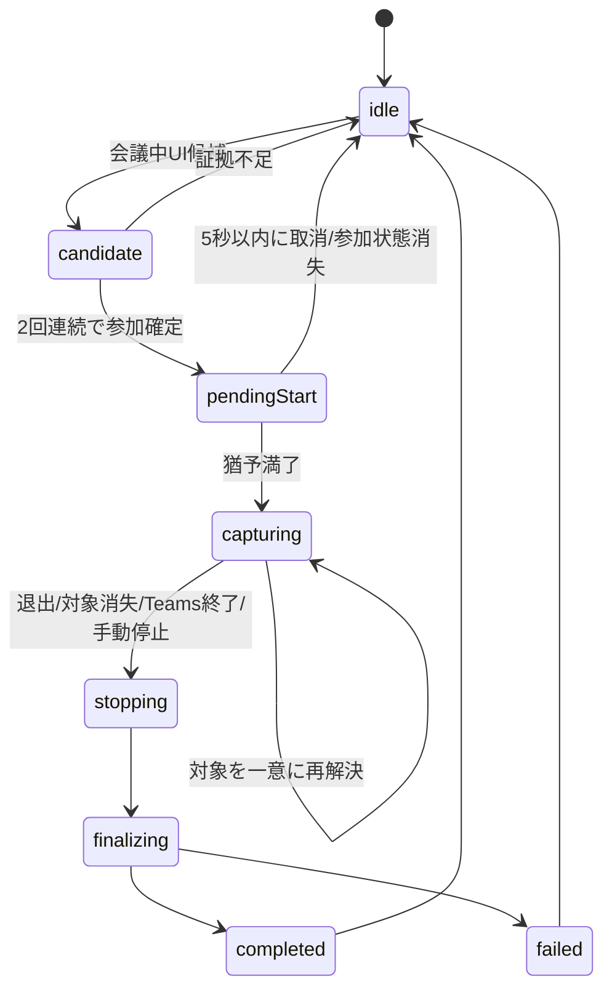

# Teams 会議自動録画 設計

## 30秒サマリー

- EventRecorder を手動起動している間、Microsoft Teams の実参加を検出し、5秒の取消猶予後に自動録画する。
- scheduled meeting、Meet Now、1対1通話、グループ通話を対象とし、カレンダー時刻やTeamsプロセス起動だけでは開始しない。
- 映像はTeams会議ウィンドウだけに限定し、対象を見失った場合は停止する。ディスプレイ全体へはフォールバックしない。
- 音声はTeamsアプリのシステム音声だけを収録し、本人マイク、ログイン時常駐、参加者告知、外部送信は実装しない。
- 実現可能性は Yellow。Teams UIのアクセシビリティ表現と、ウィンドウ限定時のTeams音声範囲を実機で検証する必要がある。

## Sources Used

- 既存の `ScreenCaptureService`、`CaptureSessionController`、manifest、停止/finalize検証。
- Apple `SCContentFilter(desktopIndependentWindow:)` と ScreenCaptureKit の音声filter仕様。
- ローカル環境の Microsoft Teams bundle ID `com.microsoft.teams2`。

## 確定要件

| 項目 | 決定 |
| --- | --- |
| 本人マイク | 収録しない |
| 会議種別 | scheduled、Meet Now、1対1、グループ通話 |
| Accessibility権限 | 利用する |
| ログイン時常駐 | 実装しない |
| 開始前確認 | ローカル通知と5秒の取消猶予 |
| 保存先・保持 | 現行どおり。自動削除なし |
| 参加者告知 | 実装しない |
| 外部送信 | 実装しない |

## Known / Blocker / Open-ended / Chosen default

- Known:
  - 現行実装は選択ウィンドウをディスプレイ解決にだけ使い、ディスプレイ全体を収録する。
  - 現行停止処理は多重finalizeを防止し、stream停止、output解除、queue drain、MP3変換、manifest保存を行う。
  - ScreenCaptureKitの音声filter粒度は映像のウィンドウ粒度より粗く、Teams自身の通知音が含まれる可能性がある。
- Blocker:
  - なし。実機Teams回帰はリリースゲートとして残す。
- Open-ended:
  - Teamsのバージョンや表示言語により、Accessibility treeのラベルや構造が変わる可能性。
  - 単一window streamで相手音声が安定するか、映像・音声分離streamが必要か。
- Chosen default:
  - 参加判定は保守的に行い、曖昧なら自動開始しない。
  - 対象消失時は3秒以内に同一会議ウィンドウを一意に再解決できなければ停止する。
  - 外部ネットワーク、Google認証、Notebook連携はコードにも設定にも追加しない。

## 参加状態の判定

Teamsプロセスの存在は探索開始のヒントにだけ使う。自動開始には次をすべて要求する。

1. bundle ID が `com.microsoft.teams2` のプロセスである。
2. Accessibility treeに会議中固有の退出操作がある。
3. 同じtreeに会議操作を示す補助的な要素がある。
4. Accessibility windowと`SCWindow`をPIDおよびframeで一意に対応づけられる。
5. 同一判定を連続2回確認する。

UI文字列だけに依存しないよう、role、subrole、identifier、descriptionを優先する。日本語・英語の既知ラベルは補助情報として扱う。prejoin、lobby、Teamsホーム、カレンダー時刻、Teams起動だけでは開始しない。

## 収録境界

### 映像

- `SCContentFilter(desktopIndependentWindow:)`を使用する。
- 解像度は対象window frameとfilterのpixel scaleから設定する。
- `content.displays.first`やdisplay filterへのfallbackを削除する。
- target monitorは同一PIDの会議中windowだけを再解決候補にする。
- 一意に見つからない場合は`targetWindowLost`として停止する。

### 音声

- 本人マイクは取得しない。
- 第一候補はTeamsウィンドウfilterと同一streamのaudio output。
- 相手音声が届かない場合のみ、映像window streamとTeams application audio streamを分離する。
- display全体の音声へはフォールバックしない。
- 他アプリ通知音は含まれないことを実機で確認する。
- Teams自身の通知音はアプリ単位filterの制約として検証・記録する。

## 停止と回復

- 既存の`CaptureFinalizationGate`を維持し、どの停止理由でもfinalizeは1回だけ実行する。
- `stopReason`は`userStopped`、`participantLeft`、`targetWindowLost`、`teamsTerminated`、`streamFailed`、`systemSleep`を持つ。
- スリープ、Teams終了、stream errorでは停止経路を共有する。
- 変換・manifest失敗時は既存どおりCAFとJPEGを残す。
- 再接続や再参加は新sessionとして開始し、必要ならoptionalな`segmentGroupID`で関連づける。
- ログへ会議名、参加者名、URL、window title、保存先絶対pathを出さない。

## UIと権限

- UIに「Teams自動録画」toggleを追加する。アプリ起動ごとに明示的な状態を表示する。
- Accessibility権限状態、Teams監視状態、開始猶予を表示する。
- 参加検出時はローカル通知を出し、5秒間UIから取消可能にする。
- ログイン項目、LaunchAgent、SMAppServiceは追加しない。
- 通知が拒否されていてもアプリ内の取消UIは表示する。

## Manifest互換拡張

既存manifestをdecodeできるよう、次をoptionalで追加する。

- `trigger: manual | teamsAutomatic`
- `captureScope: display | window`
- `audioScope: display | application`
- `stopReason`
- `segmentGroupID`
- `microphoneIncluded`
- `presenceEvidenceVersion`

Teams自動モードではwindow titleを永続化しない。

## 非対象

- 本人マイク録音。
- ログイン時自動起動。
- 会議参加者への通知やTeams bot投稿。
- Calendar/Graph APIによる参加判定。
- NotebookLM/Gemini Notebook、Google Drive、その他外部サービスへの送信。
- browser自動操作、Googleログイン、API token保存。

## レビュー 1/5〜5/5

- 1/5 要件: 対象会議、マイクなし、手動起動、外部送信なしを反映。
- 2/5 プライバシー: window限定、fallback禁止、PII非ログを反映。
- 3/5 ライフサイクル: 取消、退出、対象消失、sleep、失敗を停止経路へ統合。
- 4/5 互換性: macOS 13、既存finalize、旧manifest decodeを維持。
- 5/5 検証可能性: 判定fixture、filter構築、実機Teams音声を独立ゲート化。

## Context Compression

EventRecorderを手動起動中に限り、AccessibilityでTeamsへの実参加を保守的に検出し、5秒の取消猶予後、会議windowだけの映像とTeams音声を記録する。対象を見失えば停止し、全画面fallback、本人マイク、常駐登録、参加者告知、外部送信は行わない。
